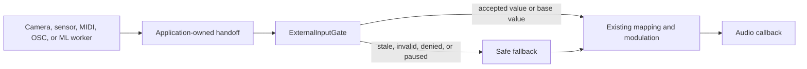

# Real-world inputs

Real-world inputs let a Pulp application turn signals from devices and other
software into musical control. You can use a facial expression to move a
synthesizer filter, move your hands through a granular texture, tilt a phone
to change pitch or reverb, or use a gesture to trigger samples. A
TouchDesigner or Max/MSP patch can control a Pulp instrument over OSC, and a
custom machine-learning model can become an expressive interface. Several
physical inputs can feed different controls in the same instrument.

These are integration patterns, not turnkey face tracking or gesture products.
Your application or companion process captures the signal and decides what it
means; Pulp provides a consistent, real-time-safe way to deliver, validate,
and expire the resulting control data.

## What is available today

Pulp ships a small provider-neutral contract in the runtime SDK:
`pulp::runtime::ExternalInputFrame<N>` carries one observation and
`ExternalInputGate<N>` validates it for a consumer. The core replay and ingress
tests and the `examples/cv-control` application exercise this contract. The
TouchDesigner and Fairlight sections are optional recipes with synthesized
evidence; they do not mean those products are installed or validated on every
machine. A live camera, phone, named host, or model still needs an
application-specific acceptance run.

Pulp handles bounded frame storage, source and restart identity, ordering,
confidence and value validation, status changes, and sample-count staleness.
It does not capture devices, request permissions, run inference, own model
weights, or write saved parameters from a provider thread. Those responsibilities
stay with your application.

## How the contract works

A provider publishes one complete observation at a time. The frame carries a
source identity, a provider restart epoch, sequence and provider time, status,
confidence, and a bounded array of application-defined values. The gate accepts
only well-formed frames that meet the consumer policy. `invalid`, `unavailable`,
`denied`, and `paused` statuses expire the accepted value. Advance the gate once
per audio block with the block sample count; it never compares a provider clock
with the audio clock.

Providers and applications own capture, permissions, inference, lifecycle, and
mapping. Use an existing `TripleBuffer`, SPSC queue, OSC, IPC, MIDI, or WAM
handoff; do not add a provider-specific transport or schema to Pulp core. See
the [licensing boundary](../reference/licensing.md#application-selected-provider-and-host-integrations)
for why application-selected providers are not Pulp-redistributed dependencies.

## Quick start: one value from any provider

Capture and inference happen on a provider or worker thread. At the handoff,
translate the result into Pulp's frame, submit it to a gate, then read the
accepted value while processing audio. The excerpt below uses only the public
runtime API and is complete C++ apart from the provider's frame transport. The
provider could be a camera model, phone sensor, MIDI device, or OSC receiver.

```cpp
#include <cstdint>
#include <span>
#include "pulp/runtime/external_input.hpp"

using namespace pulp::runtime;
using Frame = ExternalInputFrame<1>;

void process_block(ExternalInputGate<1>& gate,
                   const ExternalInputPolicy& policy,
                   bool has_new_frame,
                   const Frame& frame,
                   std::span<float> output,
                   float base_parameter) noexcept {
    // The application reads its latest complete frame from a TripleBuffer,
    // OSC/IPC receiver, MIDI adapter, or another existing handoff.
    if (has_new_frame)
        (void)gate.submit(frame, policy);

    // No new frame is still a valid audio block: keep the last accepted value,
    // or use the base parameter until the first value is accepted.
    const float control = gate.valid() ? gate.value(0, 0.0f) : 0.0f;
    const float effective = base_parameter + control;
    for (float& sample : output)
        sample = effective; // replace with the application's existing DSP

    // Advance once with this block's actual sample count.
    gate.advance(static_cast<std::uint64_t>(output.size()), policy);
}
```

The provider constructs a frame away from the callback and the application-owned
handoff supplies `has_new_frame` and `frame`. A duplicate sequence returns
`unchanged`; an older sequence or provider timestamp is rejected. A new epoch
allows a provider restart, while `advance` expires an accepted value after the
configured sample budget. None of these cases stops the callback from writing
audio: it continues with the last accepted value or the base parameter.

The public runtime types are the frame, policy, gate, verdict, and status shown
above. Keep related values in one frame so a hand pose, face pose, or IMU
orientation cannot be assembled from different updates. The
`examples/cv-control` application shows a fuller mapping and ingress example;
its `ControlSample` and `SignalMapping` remain application-owned.



## Choosing a handoff

| Source and consumer | Recommended existing path |
|---|---|
| Native provider to the same application or plugin process | Application-owned `TripleBuffer<T>` or another existing bounded runtime primitive. |
| External process to a desktop/plugin consumer | Existing OSC or IPC. Keep the external process responsible for camera/device permissions and inference. |
| Browser provider to a WAM processor | Existing WAM MIDI ingress; the example reserves channel-16 pitch bend for one compact control packet. |
| Host automation or musical control | Existing MIDI/MPE and StateStore/modulation paths. |
| Mobile app to a mobile plugin or companion process | Application-owned platform handoff or an optional external transport selected by the host. |

The handoff must have one clear writer and one audio-side reader. If several
providers can be selected, the application owns arbitration and provider
lifecycle; do not concurrently write the same `TripleBuffer` from multiple
providers.

## Mapping and failure behavior

Keep the saved or host-automated parameter as the base. Add or otherwise
explicitly combine the ephemeral input value, and expose the effective value
through the existing modulation/display path. Define these cases in the
application and test them with replay:

- confidence below the application gate;
- malformed or non-finite values;
- no provider or denied permission;
- provider restart and sequence reset;
- stale input after a provider stops;
- lifecycle pause/resume and unavailable hardware.

Capture and inference must stop before the application tears down their
provider resources. Audio processing must remain allocation-free and
non-blocking after preparation.

## Surface and host boundaries

- **Web/WASM:** camera and sensor APIs require browser permission and an
  allowed origin. Web Bluetooth, HID, Serial, DeviceMotion, and inference
  availability vary by browser. The mapping can remain shared with native code
  while the provider is browser-specific.
- **Standalone desktop:** native camera, IMU, BLE, serial, USB, HID, or an
  external provider may own the device. The provider must publish off the audio
  thread.
- **Audio plugins:** assume the host may deny camera/device access. Prefer a
  companion process, OSC/IPC, host MIDI, or host automation when direct access
  is unavailable.
- **iOS and Android:** Core Motion, platform sensors, camera, BLE, and mobile
  ML APIs belong to the application adapter. Permissions and pause/resume are
  platform-owned. AUv3 or other mobile plugin sandboxes may require an app or
  companion process to provide the input.

### Mobile adapter recipe

The mobile adapter can stay small because it only translates a platform event
into the same application-owned frame used by the desktop and web providers.
For example, an Android app can sample a rotation sensor on a non-audio
dispatcher and pass the normalized result to its existing handoff:

```kotlin
private val listener = object : SensorEventListener {
    private var sequence = 0L

    override fun onSensorChanged(event: SensorEvent) {
        if (event.sensor.type != Sensor.TYPE_ROTATION_VECTOR) return
        val value = normalizeTilt(event.values) // application calibration
        publishFrame(
            sequence = ++sequence,
            control = value,
            confidence = 1.0f,
            valid = true,
            timestampNanos = event.timestamp,
        ) // TripleBuffer, OSC/IPC, or the app's native queue
    }

    override fun onAccuracyChanged(sensor: Sensor, accuracy: Int) = Unit
}

sensorManager.registerListener(
    listener,
    sensorManager.getDefaultSensor(Sensor.TYPE_ROTATION_VECTOR)
        ?: return unavailable(),
    SensorManager.SENSOR_DELAY_GAME,
    handler,
)
```

`publishFrame` is application code; Pulp does not need to know what the value
means. Stop and unregister the listener on pause, release, permission denial,
or provider restart, and publish one invalid frame if the consumer needs an
immediate loss notification. The audio callback only reads the already
published frame. The existing `com.pulp.motion` Android package is a UI motion
observability/tracing facade, not a physical sensor API; do not use it as
evidence that an accelerometer or gyroscope is already wired to parameters.

An iOS application follows the same boundary with `CMMotionManager`:

```swift
motion.startDeviceMotionUpdates(to: providerQueue) { [weak self] sample, _ in
    guard let sample else { return }
    self?.publishFrame(
        sequence: self?.nextSequence() ?? 0,
        control: normalizeTilt(sample.attitude.roll),
        confidence: 1,
        valid: true,
        timestamp: sample.timestamp
    )
}
```

The optional `PulpSwift` package includes the small
`PulpMotionControlSource` adapter for this boundary. A host application only
needs to select its handoff and mapping:

```swift
let source = PulpMotionControlSource { frame in
    // This closure runs on the provider queue, never in the audio callback.
    controlHandoff.publish(frame)
}
guard source.start() else {
    controlHandoff.publishUnavailable()
    return
}
// Call source.stop() from the app/plugin lifecycle teardown.
```

`PulpMotionControlFrame` carries the sequence, normalized value, confidence,
validity, and timestamp as one observation. `PulpMotionControlMath` is pure
and testable without an iPhone. The package does not request permissions or
write parameters; the containing app owns the Info.plist usage description,
mapping, and external handoff.

These snippets are provider recipes, not a new Pulp sensor subsystem. A mobile
plugin that cannot access the sensor permission can receive the same frames
from its containing app or an external process over an existing transport.

### Native camera and custom-model adapters

Desktop applications can keep camera capture and inference in an optional
provider target. The application-owned output is the only part shared with the
Pulp consumer:

```cpp
// Optional application target; OpenCV is not a Pulp dependency.
cv::VideoCapture camera(0);
cv::Mat frame;
std::uint64_t sequence = 0;
while (camera.read(frame)) {
    const auto result = face_provider.infer(frame); // MediaPipe/OpenCV/custom code
    publish(FaceFrame{
        .sequence = ++sequence,
        .mouth_open = result.mouth_open,
        .confidence = result.confidence,
        .tracked = result.tracked,
    }); // TripleBuffer, OSC/IPC, or another existing handoff
}
```

For a custom ONNX model, keep the runtime and model package in the application
or an external process. The inference worker publishes one complete
application-owned frame; the audio callback never sees an `Ort::Session` or a
camera object:

```cpp
Ort::Session session(env, model_path.c_str(), session_options);
while (running) {
    auto input = next_input_frame();
    auto outputs = session.Run(Ort::RunOptions{nullptr}, input_names, &input, 1,
                               output_names, output_count);
    publish(ModelFrame{
        .sequence = ++sequence,
        .drive = normalize(outputs[0]),
        .blend = normalize(outputs[1]),
        .confidence = confidence(outputs),
        .valid = outputs_are_finite(outputs),
    });
}
```

The consumer then uses the existing example-owned `ModelMapping` and its
normal StateStore/modulation path. ONNX Runtime, OpenCV, model weights, and
their licenses remain optional and application-selected. If the model worker
stops, publishes malformed output, or loses its input, publish one invalid
frame and let the existing stale timeout and replay tests exercise the failure
policy.

OBS Studio, DaVinci Resolve/Fairlight, Max/MSP, TouchDesigner, and similar
hosts are compatibility forcing functions. They should consume existing
plugin, OSC, MIDI, IPC, WebSocket, or external-process boundaries through
optional recipes. Pulp core must not link host SDKs or copy host code. A host
adapter becomes implementation work only when a named application requires a
live acceptance receipt.

### External host boundaries

These products are useful design tests, but they do not define a new Pulp
provider or transport API:

- **OBS Studio:** a future integration can use an OBS-side plugin, an external
  OSC/WebSocket/UDP bridge, or a virtual audio/video device. Keep OBS's GPL
  code and lifecycle outside Pulp core.
- **DaVinci Resolve/Fairlight:** VST3/AU is the practical audio-plugin path;
  Resolve scripting or control-surface APIs can be reached through a separate
  companion bridge when project or video control is needed. Do not make the
  Blackmagic SDK or a Resolve installation a Pulp dependency.
- **Max/MSP, TouchDesigner, openFrameworks, vvvv, and Pure Data:** preserve
  named, inspectable signals and optional OSC/MIDI/IPC recipes so a thin host
  adapter can route them without a Pulp-specific node graph or landmark schema.
- **Zoom and Google Meet:** do not assume that a call host can load an audio
  plugin, accept arbitrary OSC, or grant a provider camera permission. A
  companion desktop/browser application, virtual microphone/camera, or a
  verified product SDK may publish controls into a Pulp app or plugin. Treat
  direct Zoom/Meet integration as a separately verified product requirement.

For any future host demo, name the boundary being exercised (for example, an
OBS filter property, a Fairlight VST3 parameter, or a companion-process input
stream). The demo must prove that boundary without implying that Pulp owns the
host's permissions, scheduling, or lifecycle.

## Optional provider and model dependencies

MediaPipe, OpenCV, OpenSeeFace, ONNX Runtime, LiteRT, Core ML, platform sensor
APIs, and device SDKs remain application-selected dependencies. Audit model
weights, task bundles, codecs, and SDK terms separately from runtime licenses.
Keep these integrations optional and outside Pulp core; applications should
include only the dependencies they use.

## Connecting TouchDesigner over OSC

TouchDesigner is an example of an external sharing application. This recipe is
outside Pulp and requires a pinned TouchDesigner build on the host. Create
an OSC Out CHOP or DAT that sends UDP to `127.0.0.1:9001` with the existing
`examples/cv-control` message shape:

```text
/pulp/control <float value> <float confidence> <int valid> [int sequence]
```

The Pulp application maps the message to `ExternalInputFrame<1>` with its
configured `source_id`, current provider `epoch`, sequence, `valid` status,
confidence, and one value. TouchDesigner owns any camera, sensor, or MediaPipe
operator and its permissions; Pulp receives only the normalized application
value through the existing OSC ingress. MediaPipe may be used inside
TouchDesigner or a companion process as an optional provider, but Pulp does not
bundle its SDK, model, permissions, or landmark schema.

The fixture at
`test/fixtures/external-input/t7-touchdesigner-synthesized.jsonl` exercises the
positive frame, below-threshold confidence, paused status, restart epoch,
and silence-to-expiry cases. It is explicitly marked `synthesized`: this host
does not have TouchDesigner installed, so it is not a live TouchDesigner
acceptance receipt. A live receipt must record the exact TouchDesigner version,
OS, destination port, patch/operator identity, and a captured packet sequence
before this recipe can be treated as validated on a live host.

## Using Pulp plugins in DaVinci Resolve / Fairlight

The Fairlight acceptance path is host-only and does not add a Blackmagic SDK
or Resolve dependency to Pulp. Install an exact Resolve version, place a built
Pulp VST3 in the host's plugin search path, and record the plugin identity,
project, timeline, track, and parameter automation. The receipt must show a
before/after host automation value reaching the plugin's existing
`get_modulated` path.

`examples/cv-control` currently declares `CvFaceTone` as a VST3 instrument and
does not expose an input bus. Verify that the selected Fairlight version loads
VST3 instruments and automates its Brightness parameter before claiming a live
Fairlight integration. If it only accepts effects, use an existing Pulp VST3
effect with a clearly automatable parameter or leave the integration
unverified; do not change core solely to force host compatibility.

The receipt fixture at
`test/fixtures/external-input/t10-fairlight-receipt.json` is an evidence
template, not a live host result.
This checkout has no DaVinci Resolve installation, so it deliberately records
that live-host evidence is still missing.
